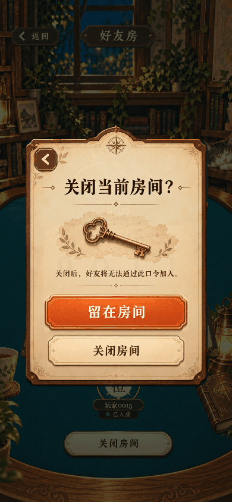

# 好友房返回好友对战：转场修复

原因：等待房间离开后，`stateChanged()` 直接重绘 `Interface`，销毁了好友房纸面，因此返回没有页面衔接。

修复：收到服务器确认房间已离开的状态后，保留当前 `FriendRoom` 节点，在独立层中向右退场、轻微倾斜和淡出；好友对战页从左侧接回，键盘延后浮入。总时长 0.64 秒，键盘从 0.18 秒开始出现。两页共用 `friend` 场景，不切换或重建书房背景。重新加载资源、网络回调或普通重绘保留当前动画时间。

仅“等待中的好友房 → 无房间且未排队”触发返回；取消、关闭失败和对局结束离开均不触发此动画。返回目标明确为好友对战页，重连恢复的房间也不会误返大厅。转场期间遮挡触摸及物理数字键；关闭动效时立即返回；有新房间或页面切换时清理旧过渡层。

复用已有切图，没有新增运行时美术资源。实现位于 `assets/scripts/FriendReturnLayer.ts`、`assets/scripts/shared/friend-return.ts` 与 `GameApp.ts`。

[逐帧对照](friend-return-frames.jpg) · [返回完成](friend-return-settled.png) · [短屏且动效关闭](friend-return-short.png)

## 验证

- 真实本地服务器：大厅 → 好友对战 → 创建好友房 → 返回 → 取消，原房间保留。
- 浏览器中注入一次关闭命令失败，确认无误退场；恢复真实命令后关闭成功，回到好友对战。
- 连续帧中目标页始终是 `join`、背景始终是 `friend`；服务器房间已离开。
- 动画中主动重绘，时间不归零；数字键和创建按钮点击被阻挡；结束后可以再次输入，旧好友房节点已清理。
- 390 × 844 视口完成动画录制；375 × 667 视口关闭动效后立即返回。
- `npm test` 36 项通过；`npm run typecheck`、`npm run typecheck:client` 通过。
- Web 辅助构建与 `npm run build:wechat` 成功。微信导出目录 `build/wechatgame/`，品牌与主包检查通过。
- 尚未做微信开发者工具真机验证或正式发布。

复现：启动本地服务与 Web 预览，运行 `node scripts/verify-friend-return.cjs`（可用 `PLAYWRIGHT_MODULE` 指定 Playwright 安装目录），然后运行 `python3 scripts/pack-friend-return.py`。GIF 使用真实截图与采集时间间隔，采样帧率低于游戏帧率，没有合成中间画面。检查记录见 `friend-return-checks.json`。
