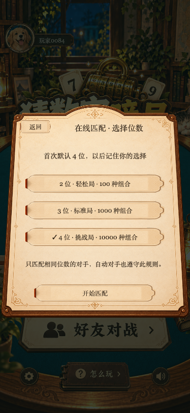
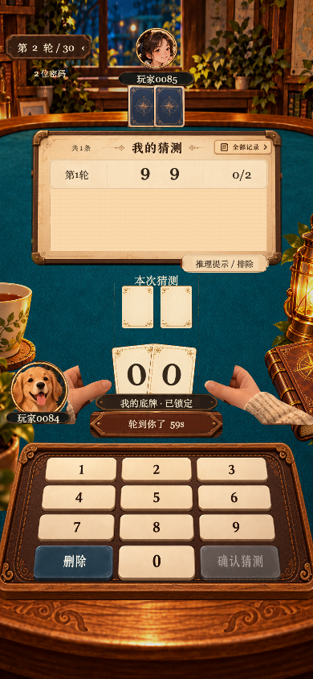
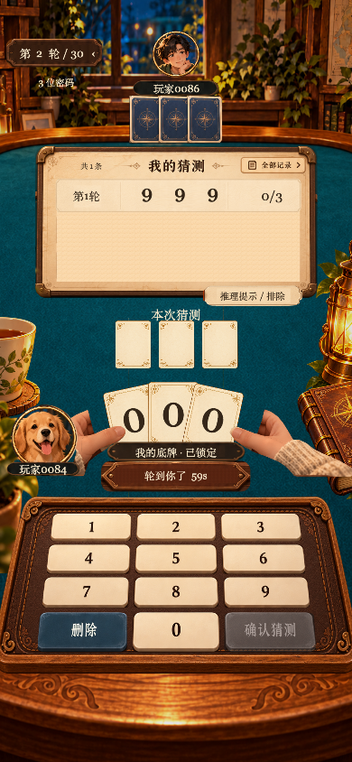
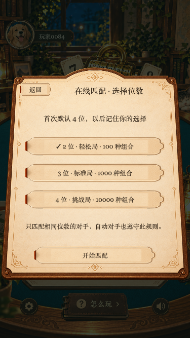

# 正式多档位验证

日期：2026-10-30。

- `npm test`：86 项通过，含三档输入/反馈/补猜、匹配隔离、同档机器人准备与猜测、好友房返回、默认与非法位数、账号/入口偏好键。
- 服务端、客户端 TypeScript 检查通过。
- Web 实际交互脚本 `scripts/smoke-game-modes.mjs` 通过：首次默认四位；选择两位并确认后重新加载仍预选两位；取消改选三位不覆盖原偏好；好友房入口独立默认四位；三档好友局均完成锁牌确认、重复猜测取消、逐位推理、破解结算和返回房间，返回后保持位数；房间口令始终四位。390×844 与 375×667 布局通过，无页面 JavaScript 异常。
- 原 `scripts/smoke-learning.mjs` 完整通过，教学、2/3/4 位练习和四位正式对局不回退。
- 微信导出 `build/wechatgame/` 成功，包体检查通过：主包约 2311 KB，总计约 27799 KB。
- 未进行微信开发者工具、Android / iOS 真机验证，未部署远端服务或正式发布。记忆是当前账号的本机偏好，不跨设备同步。

