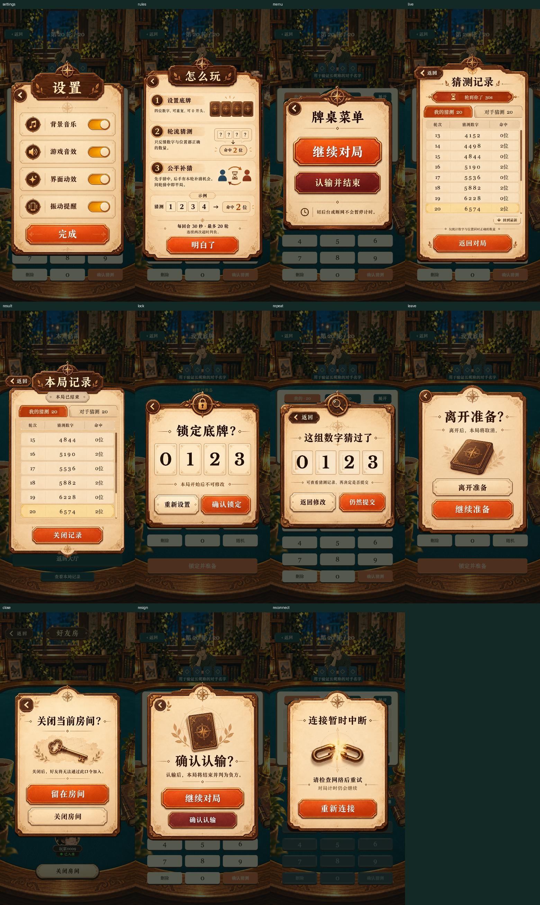

# 弹窗还原验证

测试对象：`docs/design/modals/` 的 11 类设计稿，Cocos Creator 3.8.8 Web 辅助构建。

## 复现

1. 完成 `npm run build:web`。
2. 分别启动 `npm run server` 和 `npm run preview`。
3. 在已安装 Playwright 和 Chrome 的环境执行 `node scripts/verify-modals.cjs`。如复用其他位置的 Playwright，可设置 `PLAYWRIGHT_MODULE` 为其模块目录；预览地址可用 `PREVIEW_URL` 覆盖。

脚本在测试浏览器内注入可复现的房间数据，并拦截确认命令记录参数，不给正式客户端增加调试入口。手动重连用真实本地服务器重新认证。截图不是微信真机截图。

## 已检查

- 390 × 844 与 375 × 667 两种视口；纸张、按钮、文字和命中区域整体适配，短屏底部按钮不裁切。
- 11 类弹窗截图：`modals-settings.png`、`modals-rules.png`、`modals-menu.png`、`modals-live.png`、`modals-result.png`、`modals-lock.png`、`modals-repeat.png`、`modals-leave.png`、`modals-close.png`、`modals-resign.png`、`modals-reconnect.png`。
- 设置开关实际点击与持久化；完成、规则确认、菜单认输入口和返回。
- 五类确认的取消不发送命令；确认发送对应动作。打开后把草稿改成 9999，锁定与重复猜测仍提交打开时的 0123。
- 40 条双方猜测、超时行、长对手昵称；记录实际鼠标拖动、重绘保持偏移、回到最新、对手标签切换。
- 空记录、短屏设置和规则分别保存在 `modals-short-*.png`；设计稿示例记录不会残留在空态。
- 回合改变时旧重复确认自动关闭；单元测试另覆盖换房、换人、已锁定、结束及补猜阶段。
- 断线时显示独立阻挡层；实际点击重新连接并等待本地服务器认证成功。
- 浏览器未捕获运行异常。机器可读结果见 `modals-checks.json`。

## 边界

Web 运行数据含测试夹具，不能代替完整真人对局验收。微信小游戏已本地导出到 `build/wechatgame/`，尚未做开发者工具真机验证或正式发布。原稿中的纸张隐藏区域以同稿纹理修补，输出 PNG 使用调色板压缩，不能称为全图无损还原。
