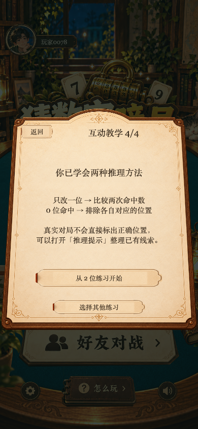
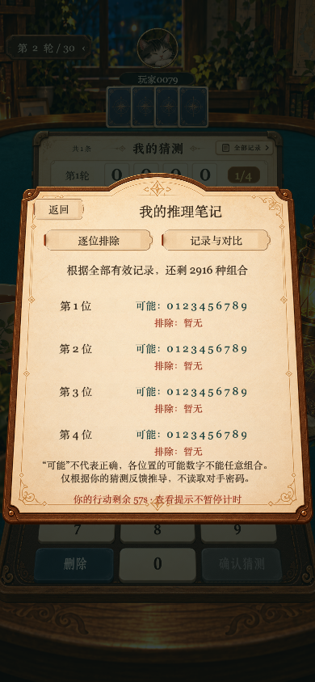
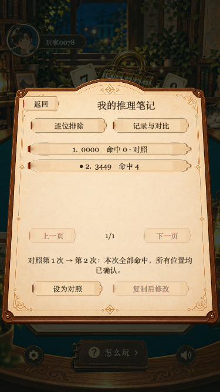

# 新手引导与推理提示验证

验证日期：2026-10-30。

- `npm test`：75 项全部通过。
- `npm run typecheck`、`npm run typecheck:client`：通过。
- `npm run build:web`：通过，用于本地交互检查。
- `scripts/smoke-learning.mjs`：Chrome 中实际点击教学正确/错误分支、2/3/4 位练习、前导零、复制修改、通关、规则页、390×844 与 375×667 布局。页面无 JavaScript 异常。
- 同脚本建立本地双客户端好友局，检查快照的 30 大轮 / 60 秒参数；输入 `0000` 对固定测试谜底 `0123` 得到命中 1 位、2916 个一致候选；提示倒计时持续变化；复制回草稿；对手认输后面板自动关闭。
- `npm run build:wechat`：成功，导出 `build/wechatgame/`；主包 2305.3 KB、资源包 25487.6 KB、总计 27792.9 KB，包体检查通过。
- 未执行微信开发者工具、Android / iOS 真机验证，未部署远端服务，未正式发布。

截图：

发现并修复：Cocos loose spread 转换导致字符串和 Set 展开结果与 Node 不同，候选列表曾出现 `[object Set]`。算法已改为 `Array.from`，交互回归同时断言构建后教学反馈为 `[2,1]`、候选为单个数字、正式局候选数为 2916，以及练习可通关。
